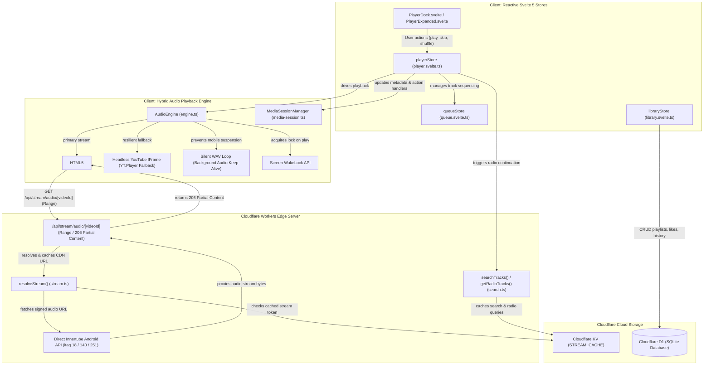
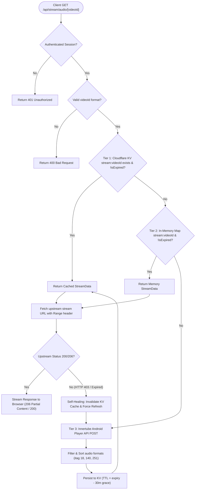
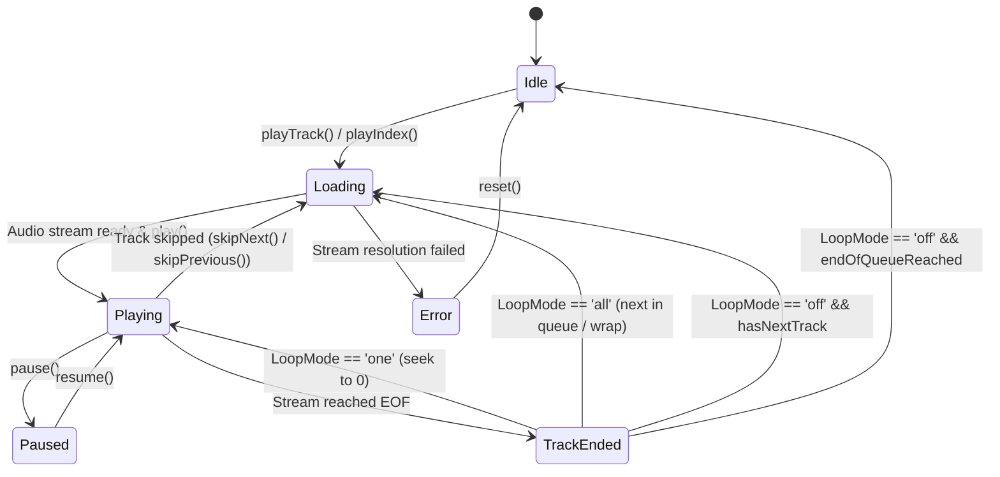

# Music Streaming & Playback Architecture Mechanism — Villu Online

> **Document Scope**: This specification records the technical architecture, data pipelines, Web Audio engine, edge stream resolution tiers, audio proxying algorithms, concurrency controls, queue state machines, and persistence layers powering **Music Streaming and Audio Playback** in Villu Online. Application UI styling, general routing, and themes are auxiliary; this document focuses on audio lifecycle, streaming, and queue mechanics.

---

## 1. Architectural Overview & Component Topology

The Villu Online audio subsystem operates across three synchronized execution environments:
1. **Client-side Reactive State & UI Layer**: Powered by SvelteKit (Svelte 5 Runes) managing player dock, expanded player, and queue state.
2. **Client-side Hybrid Audio Playback Engine**: HTML5 Audio paired with an off-screen YouTube IFrame fallback, WakeLock, and W3C MediaSession API.
3. **Cloudflare Workers Serverless Edge Backend**: Edge audio proxy with HTTP 206 byte-range seeking, stream resolution via Innertube API, Cloudflare KV stream cache, and Cloudflare D1 SQLite database.



---

## 2. Hybrid Audio Playback Engine & Background Execution

Files: [`src/lib/audio/engine.ts`](file:///home/gokul/Dev/Github/self/villu_online/src/lib/audio/engine.ts), [`src/lib/audio/media-session.ts`](file:///home/gokul/Dev/Github/self/villu_online/src/lib/audio/media-session.ts)

### 2.1 Dual-Mode Hybrid Architecture
Desktop and mobile browsers impose strict restrictions on audio playback, auto-play, background thread sleeping, and codec licensing. Villu Online resolves this via a dual-mode engine:

1. **Native HTML5 Audio (Primary)**:
   - Uses an `HTMLAudioElement` fetching from the self-hosted audio proxy `/api/stream/audio/[videoId]`.
   - Supports arbitrary byte-range seeking (`Accept-Ranges: bytes` / `206 Partial Content`).
   - Ensures native operating system media pipeline integration with low battery overhead.
2. **Headless YouTube IFrame Player (Resilient Fallback)**:
   - When native streaming is blocked (e.g. strict corporate firewalls, region blocks, or expired CDN tokens), the engine seamlessly fails over to an off-screen zero-opacity YouTube IFrame player (`YT.Player`).
   - Container `#villu-player-container` is anchored off-screen (`bottom: -300px; right: -300px; width: 200px; height: 200px; opacity: 0.001; pointer-events: none`).

### 2.2 Background Audio Keep-Alive on Mobile Browsers
Mobile operating systems (iOS Safari, Android Chrome) aggressive throttle or suspend JavaScript timers and audio elements when the screen turns off or the browser is minimized:
1. **Silent RIFF WAV Loop**: A 48-byte base64 silent WAV audio URI (`SILENT_WAV`) runs in a secondary looping `HTMLAudioElement` at non-zero volume (`volume = 0.001`), preventing the browser's audio hardware session from being reclaimed.
2. **Screen WakeLock API**: On play and visibility state change (`visibilitychange`), the engine acquires `navigator.wakeLock.request('screen')` to prevent CPU throttling while tracks are actively streaming.

### 2.3 Seamless Lookahead Preloading Engine
To eliminate buffering delays between tracks:
- During playback, the engine monitors `timeupdate`:
  ```typescript
  if (dur > 25 && dur - pos < 20 && !this.preloadTriggered) {
      this.preloadTriggered = true;
      this.callbacks.onPreloadNeeded();
  }
  ```
- When a track has less than 20 seconds remaining, [`playerStore.preloadNextTrack()`](file:///home/gokul/Dev/Github/self/villu_online/src/lib/stores/player.svelte.ts#L203-L209) queries `queueStore.nextTrack`.
- The engine pre-fetches `/api/stream/audio/[nextVideoId]` into a secondary detached audio element, warming the Cloudflare KV cache and edge proxy buffers before the current track finishes.

### 2.4 True Decoded Duration Patching
YouTube metadata API durations are integer estimates rounded to nearest seconds and frequently mismatch physical audio frames. The engine dynamically patches the reactive duration when true container metadata decodes:
```typescript
if (dur > 0 && Math.abs(this._duration - dur) > 1) {
    this._duration = dur;
}
```

---

## 3. Stream Resolution Pipeline & Universal Edge Audio Proxy

Files: [`src/lib/server/stream.ts`](file:///home/gokul/Dev/Github/self/villu_online/src/lib/server/stream.ts), [`src/routes/api/stream/audio/[videoId]/+server.ts`](file:///home/gokul/Dev/Github/self/villu_online/src/routes/api/stream/audio/[videoId]/+server.ts)

When audio is requested, the edge worker executes a multi-tier resolution and proxying pipeline:



### 3.1 3-Tier Resolution Engine
1. **Tier 1: Cloudflare KV Cache (`STREAM_CACHE`)**:
   - Queries `stream:<videoId>`.
   - Validates expiration using token timestamp matching `[?&]expire=(\d+)`.
   - **30-Minute Grace Window**: If token expiration timestamp is within 30 minutes of current time, it is treated as expired to prevent audio stream dropouts mid-song.
2. **Tier 2: In-Memory Bounded Map**:
   - Fallback cache used during local development or when KV namespace is unbounded.
3. **Tier 3: Direct Innertube Android Player API**:
   - Executes raw HTTP POST against `https://www.youtube.com/youtubei/v1/player?prettyPrint=false`.
   - Client emulation: `clientName: 'ANDROID'`, `clientVersion: '21.02.35'`, `androidSdkVersion: 30`.
   - Mobile client bypass: Avoids OAuth challenges, bot blocks, and signature cipher decryptions required by desktop clients.
   - Quality & Format Priority:
     - `itag 18`: Progressive MP4 (AAC audio track). Highly prioritized because progressive streams include `ratebypass=yes`, allowing unconstrained HTTP byte-range requests across all browsers.
     - `itag 140`: AAC audio stream (128 kbps).
     - `itag 251`: Opus audio stream (160 kbps).

### 3.2 Universal Audio Proxy & Byte-Range Streaming
Modern HTML5 media elements require standard HTTP Range requests (`Range: bytes=start-end`) to support scrub seeking, scrubbing previews, and buffering:
- Incoming client `Range` header is forwarded directly upstream to the Google Video CDN.
- Upstream response headers (`Content-Type`, `Content-Range`, `Content-Length`, `Accept-Ranges: bytes`) are forwarded back to the client.
- Status code is normalized: `206 Partial Content` if `Range` was requested; `200 OK` otherwise.

### 3.3 Self-Healing HTTP 403 Retry Loop
If Google Video CDN rejects an active stream with HTTP 403 (e.g. IP binding change, CDN node rotation, or token expiration):
1. The proxy catches `!upstreamRes.ok`.
2. Triggers `resolveStream(videoId, STREAM_CACHE, true)` with `forceRefresh = true`.
3. Bypasses KV, resolves fresh signed tokens from Innertube, re-attempts upstream fetch, and streams transparently without surfacing errors to the player.

### 3.4 Anti-Bot Verification & YouTube Cookie Injection
If YouTube triggers rate limits or bot verification checks, Villu Online supports injected YouTube session cookies:
- Checked via environment variable `YOUTUBE_COOKIE` in `wrangler.jsonc` or database setting `youtube_cookie` in D1 `system_settings`.
- Injected automatically into Innertube request headers.

---

## 4. Search, Home Feed & Radio Continuation Pipelines

File: [`src/lib/server/search.ts`](file:///home/gokul/Dev/Github/self/villu_online/src/lib/server/search.ts)

### 4.1 Search Engine
- **Primary Source**: YouTube Music (`WEB_REMIX` client).
- **Secondary Source**: YouTube Android (`ANDROID` client) fallback if Music returns empty results.
- **Caching**: Multi-tier caching with bounded in-memory LRU (`MAX_IN_MEMORY_CACHE = 50`) and Cloudflare KV (`search:<query>` with 2-hour TTL).

### 4.2 Endless Radio Continuation Engine
When a single song is played or the queue reaches near exhaustion:
1. `triggerRadioContinuation(videoId)` invokes `/api/radio/[videoId]`.
2. Backend queries Innertube Next API endpoint: `https://music.youtube.com/youtubei/v1/next` with `playlistId: RDAMVM<videoId>`.
3. Parses `musicQueueRenderer` and `playlistPanelVideoRenderer` items.
4. Returns recommended tracks.
5. Frontend appends recommendations via [`queueStore.addBatch(tracks)`](file:///home/gokul/Dev/Github/self/villu_online/src/lib/stores/queue.svelte.ts#L107-L127) without disrupting active playback.

---

## 5. Queue State Machine & Playback Control

Files: [`src/lib/stores/queue.svelte.ts`](file:///home/gokul/Dev/Github/self/villu_online/src/lib/stores/queue.svelte.ts), [`src/lib/stores/player.svelte.ts`](file:///home/gokul/Dev/Github/self/villu_online/src/lib/stores/player.svelte.ts)



### 5.1 Full-Queue Unbiased Shuffle Mechanism
To guarantee that **all songs in the queue are played exactly once** without omissions, duplicates, or premature stops:

#### Shuffle Index Generation Algorithm
When shuffle is enabled or initialized with $N$ songs and active index $C$:
$$\text{indices} = [C, \text{FisherYates}(\{0, 1, \dots, N-1\} \setminus \{C\})]$$
- Position `0` of `_shuffledIndices` is anchored to the currently playing track index $C$.
- The remaining $N-1$ track indices are shuffled using an unbiased Fisher-Yates algorithm into positions `1..N-1`.
- `_shuffledIndices.length` is strictly equal to $N$.
- Traversal via `peekNextIndex()` steps sequentially from position `0` through `N-1`.
- When position `N-1` finishes:
  - If `loopMode === 'off'`: `peekNextIndex()` returns `null`. Playback stops after exactly $N$ distinct tracks.
  - If `loopMode === 'all'`: `peekNextIndex()` loops to `_shuffledIndices[0]`.

### 5.2 Queue Mutation Synchronization
Queue modifications update `_tracks` while preserving `_shuffledIndices` integrity:

| Operation | Method | Behavior in Sequential Mode | Behavior in Shuffle Mode |
| :--- | :--- | :--- | :--- |
| **Play Next** | `insertNext(track)` | Inserts at `_currentIndex + 1`. | Inserts at `_currentIndex + 1` in `_tracks`. In `_shuffledIndices`, increments indices $\ge \text{insertPos}$ by 1 and splices `insertPos` immediately after current track's position. Guaranteed to play next without re-scrambling. |
| **Add to Queue** | `addToQueue(track)` | Appends to tail of `_tracks`. | Appends to `_tracks` and appends new index to `_shuffledIndices`. Plays once in current shuffle cycle. |
| **Add Batch** | `addBatch(tracks)` | Appends multiple tracks to `_tracks`. | Appends to `_tracks`, shuffles the new batch among themselves, and appends to `_shuffledIndices`. Existing shuffle order is undisturbed. |
| **Remove** | `removeAt(index)` | Removes track; shifts `_currentIndex` if necessary. | Removes from `_tracks`. Removes index from `_shuffledIndices` and decrements indices $> \text{index}$ by 1. |
| **Clear Upcoming** | `clearUpcoming()` | Keeps track at index 0, purges remaining. | Keeps current track, resets `_shuffledIndices = [0]`. |
| **Reorder** | `reorder(oldIndex, targetIndex)` | Re-orders `_tracks` and applies pointer preservation. | Re-orders `_tracks` and updates index pointers in `_shuffledIndices` without altering playback order. |

#### Reorder Pointer Preservation Algorithm
```typescript
if (this._currentIndex === oldIndex) {
    this._currentIndex = targetIndex;
} else if (oldIndex < this._currentIndex && targetIndex >= this._currentIndex) {
    this._currentIndex--;
} else if (oldIndex > this._currentIndex && targetIndex <= this._currentIndex) {
    this._currentIndex++;
}
```

### 5.3 Transport Controls

#### Smart Skip-to-Previous
```typescript
if (this._position > 3) {
    this.seek(0);
} else {
    const prevIdx = queueStore.peekPrevIndex();
    if (prevIdx !== null) {
        await this.playIndex(prevIdx);
    } else {
        this.seek(0);
    }
}
```
If playback has progressed past 3 seconds, the command restarts the current song. If within the first 3 seconds, it steps to the preceding track in the queue (or previous track in shuffle order).

#### Loop Mode Cycle
The repeat button cycles deterministically through three states:
$$\text{LoopMode.off} \longrightarrow \text{LoopMode.all} \longrightarrow \text{LoopMode.one} \longrightarrow \text{LoopMode.off}$$

---

## 6. Concurrency & Race Condition Guarding

File: [`src/lib/stores/player.svelte.ts`](file:///home/gokul/Dev/Github/self/villu_online/src/lib/stores/player.svelte.ts)

When users rapidly skip tracks, multiple asynchronous resolution requests overlap:
- An incremental request token `_currentRequestId` is tracked.
- At each asynchronous transition (URL resolution, engine source load), the handler verifies:
  ```typescript
  const reqId = ++this._currentRequestId;
  // ... async network resolution / playback start ...
  if (reqId !== this._currentRequestId) return; // Stale request discarded
  ```

---

## 7. Database Architecture & Serverless Persistence

Files: [`schema.sql`](file:///home/gokul/Dev/Github/self/villu_online/schema.sql), [`src/lib/server/db.ts`](file:///home/gokul/Dev/Github/self/villu_online/src/lib/server/db.ts), [`src/lib/server/admin.ts`](file:///home/gokul/Dev/Github/self/villu_online/src/lib/server/admin.ts)

### 7.1 Cloudflare D1 Relational Schema (SQLite)
The persistent serverless database stores authentication, library, and configuration data:
- `users`: User identity, PBKDF2 salt/hash, role (`admin` / `user`).
- `sessions`: Ephemeral session tokens with expiration and IP hash auditing.
- `playlists`: User-created collections with cover art and privacy toggles.
- `playlist_tracks`: Ordered join table (`position ASC`) with composite key `(playlist_id, video_id)`.
- `liked_songs`: User favorites (`(user_id, video_id)`).
- `history`: Sequential playback log with automated capping.
- `audit_logs`: Security and administrative event auditing.
- `system_settings`: Key-value storage for runtime configs (e.g. `youtube_cookie`).

### 7.2 Client-Side Session Persistence
File: [`src/lib/stores/player.svelte.ts`](file:///home/gokul/Dev/Github/self/villu_online/src/lib/stores/player.svelte.ts#L349-L377)
- **Serialization**: On `beforeunload` or track change, `saveSession()` writes `villu_prev_session` to LocalStorage containing `tracks` (first 100), `currentIndex`, `position`, `loopMode`, `isShuffle`, and `shuffledIndices`.
- **Deserialization**: On app boot, `restoreSession()` reconstitutes the queue, volume, shuffle order, and active track without auto-starting playback.

---

## 8. Platform Integration & MediaSession Orchestration

File: [`src/lib/audio/media-session.ts`](file:///home/gokul/Dev/Github/self/villu_online/src/lib/audio/media-session.ts)

Villu Online connects to the W3C Media Session API, binding web playback to native OS media overlays (macOS Control Center, Windows SMTC, Android Media Notifications, iOS Lock Screen, Linux MPRIS):
- **Metadata**: Synchronizes title, artist, album name, and a 5-tier resolution artwork array (96x96 to 512x512 JPEG).
- **Position State**: `navigator.mediaSession.setPositionState` synchronizes current scrub position, duration, and playback rate for accurate lock-screen progress bars.
- **Action Handlers**: Binds hardware media keys and lock-screen buttons: `play`, `pause`, `stop`, `previoustrack`, `nexttrack`, `seekto`, `seekforward` (+10s), `seekbackward` (-10s).
